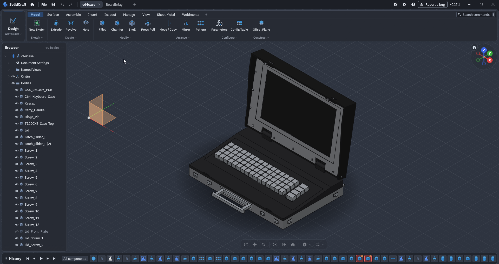
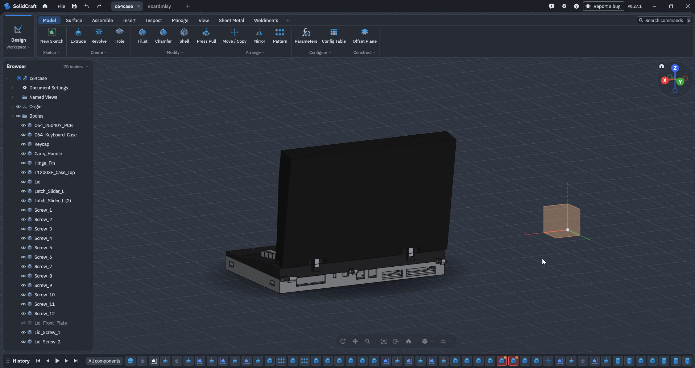
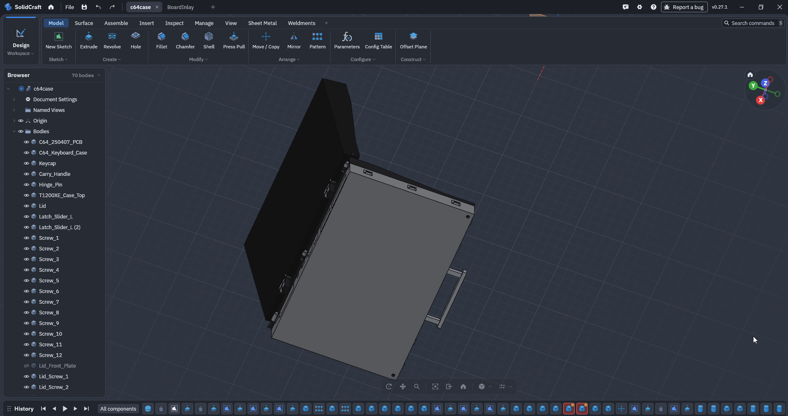

# C64Portable

🇬🇧 [English](#english) · 🇩🇪 [Deutsch](#deutsch)

---

## English

**C64Portable** is a 3D-modelled portable case for a Commodore 64 board: a briefcase-style enclosure with a hinged lid and screen frame, keyboard, carry handle, latches and screws – 70 bodies in total.

### Screenshots

### Files

| File | Description |
|------|-------------|
| `c64case.solidcraft` | Main SolidCraft project (the full case assembly) |
| `BoardInlay.sc` | Board inlay part/sketch |
| `*.bak` | Automatic backups (not tracked in git) |
| `announcement.mp4` | Short announcement video (EN/DE) |
| `splits/` | Ready-to-print STL files, split to fit the build volume of the top 10 printers (see below) |

### Pre-split STL files for popular printers

The case is larger than the build plate of most desktop printers, so the `splits/` folder contains parts that are already cut into printable pieces (`*_splt-01.stl`, `*_splt-02.stl`, …) – one subfolder per printer:

| Folder | Printer |
|--------|---------|
| `splits/Bambu-Lab-A1` | Bambu Lab A1 |
| `splits/Bambu-Lab-P1S` | Bambu Lab P1S |
| `splits/Bambu-Lab-X1-Carbon` | Bambu Lab X1 Carbon |
| `splits/Prusa-MK4S` | Prusa MK4S |
| `splits/Prusa-Core-One` | Prusa Core One |
| `splits/Creality-Ender-3-V3-SE` | Creality Ender-3 V3 SE |
| `splits/Creality-K1-Max` | Creality K1 Max |
| `splits/Anycubic-Kobra-3-Combo` | Anycubic Kobra 3 Combo |
| `splits/Elegoo-Neptune-4-Pro` | Elegoo Neptune 4 Pro |
| `splits/Sovol-SV08` | Sovol SV08 |

Each folder contains the case top and bottom, lid, lid front plate (with and without window), LCD inlays (13" and 14") and hinge pin. Larger printers need fewer pieces, so the file count per folder varies. Glue the pieces together after printing.

### Created with SolidCraft

This project was created using **[SolidCraft](https://github.com/tangency-labs/solidcraft)**.

### Thank you 🙏

A big thank you to the developers of SolidCraft at [tangency-labs](https://github.com/tangency-labs/solidcraft) for building this great tool and making it available. This project would not exist without it.

---

## Deutsch

**C64Portable** ist ein 3D-modelliertes Portable-Gehäuse für eine Commodore-64-Platine: ein koffer­artiges Gehäuse mit klappbarem Deckel und Bildschirmrahmen, Tastatur, Tragegriff, Verschlüssen und Schrauben – insgesamt 70 Körper.

### Screenshots

### Dateien

| Datei | Beschreibung |
|-------|--------------|
| `c64case.solidcraft` | Haupt-SolidCraft-Projekt (die komplette Gehäusebaugruppe) |
| `BoardInlay.sc` | Platinen-Einlage (Bauteil/Skizze) |
| `*.bak` | Automatische Sicherungen (nicht in Git enthalten) |
| `announcement.mp4` | Kurzes Ankündigungsvideo (EN/DE) |
| `splits/` | Druckfertige STL-Dateien, passend zum Bauraum der 10 beliebtesten Drucker aufgeteilt (siehe unten) |

### Vorgeteilte STL-Dateien für beliebte Drucker

Das Gehäuse ist größer als die Druckplatte der meisten Desktop-Drucker. Der Ordner `splits/` enthält deshalb bereits in druckbare Stücke zerteilte Bauteile (`*_splt-01.stl`, `*_splt-02.stl`, …) – ein Unterordner pro Drucker:

| Ordner | Drucker |
|--------|---------|
| `splits/Bambu-Lab-A1` | Bambu Lab A1 |
| `splits/Bambu-Lab-P1S` | Bambu Lab P1S |
| `splits/Bambu-Lab-X1-Carbon` | Bambu Lab X1 Carbon |
| `splits/Prusa-MK4S` | Prusa MK4S |
| `splits/Prusa-Core-One` | Prusa Core One |
| `splits/Creality-Ender-3-V3-SE` | Creality Ender-3 V3 SE |
| `splits/Creality-K1-Max` | Creality K1 Max |
| `splits/Anycubic-Kobra-3-Combo` | Anycubic Kobra 3 Combo |
| `splits/Elegoo-Neptune-4-Pro` | Elegoo Neptune 4 Pro |
| `splits/Sovol-SV08` | Sovol SV08 |

Jeder Ordner enthält Gehäuse-Ober- und Unterteil, Deckel, Deckel-Frontplatte (mit und ohne Fenster), LCD-Einlagen (13" und 14") und den Scharnierstift. Größere Drucker benötigen weniger Teile, daher variiert die Dateianzahl pro Ordner. Die Teile werden nach dem Druck verklebt.

### Erstellt mit SolidCraft

Dieses Projekt wurde mit **[SolidCraft](https://github.com/tangency-labs/solidcraft)** erstellt.

### Danke 🙏

Ein großes Dankeschön an die Entwickler von SolidCraft bei [tangency-labs](https://github.com/tangency-labs/solidcraft) dafür, dass sie dieses großartige Werkzeug entwickelt und zur Verfügung gestellt haben. Ohne es gäbe dieses Projekt nicht.
